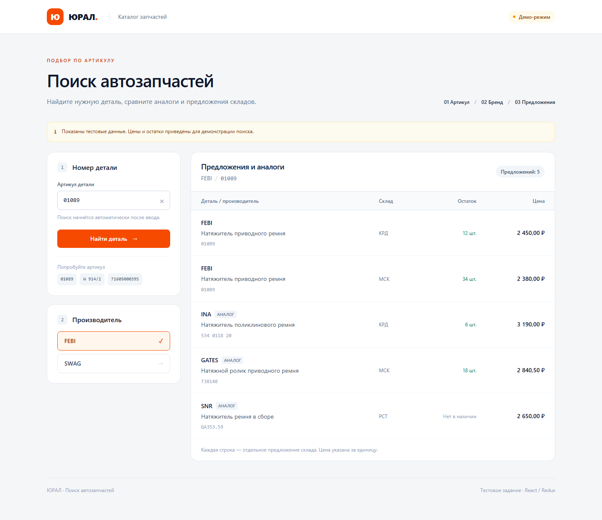

# Поиск автозапчастей

Тестовое задание для ЮРАЛ: поиск производителей по артикулу, затем предложений и аналогов выбранного бренда.

React, Redux Toolkit / RTK Query, JavaScript, Tailwind CSS, Vite. Небольшой сервер на Express хранит ключ API и передаёт запросы в Favorit Parts.



## Запуск

Нужен Node.js 22.12 или новее.

```sh
npm ci
npm run dev
```

Приложение откроется по адресу http://localhost:5173.

Без ключа работает демо-режим. В интерфейсе есть отметка о тестовых данных и три примера: `01089`, `W 914/2`, `7160500039S`. Для неизвестного артикула возвращается пустой результат. Демо-цены, остатки и соответствия аналогов не подходят для реального подбора деталей.

## Подключение Favorit Parts

Создайте `.env` по образцу `.env.example` и заполните `FAVORIT_API_KEY` своим ключом покупателя. Затем перезапустите сервер. Ключ не отправляется в браузер, не включается в сборку и исключён из Git.

Клиент написан по [документации API](https://lk.favorit-parts.ru/static/wsprice.pdf). Сервер обращается к `https://api.favorit-parts.ru/hs/hsprice/`:

- Первый запрос передаёт `key` и `number`; из `goods` собирается список уникальных брендов.
- Второй добавляет `brand` и `analogues=on`; в таблицу попадают исходные товары и вложенные `analogues`.
- Каждая строка соответствует отдельному складу. Цена берётся из `warehouses[].price`, остаток — из `warehouses[].stock`. Устаревшее поле `goods[].price` не используется.
- Товар без складов остаётся в выдаче с доступным общим остатком и без цены. Нулевой остаток отображается как «Нет в наличии».

Настоящего ключа при разработке не было: полный поиск в живом API не проверен. HTTPS-адрес сервиса отвечает; обработка контракта проверена тестами. При настроенном ключе ошибки API показываются пользователю и не подменяются демо-данными.

## Как устроено

`src/App.jsx` связывает поиск и результаты. В Redux хранятся введённый артикул и выбранный бренд, RTK Query отвечает за запросы и их состояния. `SearchResults` показывает загрузку, ошибку, пустую выдачу или таблицу. `src/api/normalize.js` разбирает товары и склады. `server/favorit.js` работает с внешним сервисом, `server/demo.js` содержит демонстрационные данные.

Запрос запускается через 350 мс после ввода или сразу по кнопке / Enter. Изменение артикула и повторный поиск сбрасывают выбор производителя и предложения. Возврат к артикулу или бренду запускает новый запрос, чтобы обновить цены и остатки. Результаты читаются из `currentData` для текущих параметров, поэтому запоздалый ответ предыдущего поиска не заменяет новую выдачу.

Есть состояния загрузки, пустой выдачи и ошибок с повтором запроса. До загрузки настроек поиск недоступен: демо-данные не появятся без соответствующей пометки. На узких экранах блоки располагаются вертикально, склад переносится в ячейку с деталью.

## Проверка и сборка

```sh
npm test
npm run format:check
npm run build
npm start
```

`npm start` запускает сервер с готовой сборкой на том же порту. Просто открыть `dist/index.html` недостаточно: приложению нужны серверные маршруты `/api/config` и `/api/search`. Сервер по умолчанию доступен только локально.

Тесты покрывают два этапа поиска, задержку ввода, смену артикула, устаревшие ответы, повтор после сетевой ошибки, пустые результаты, складские цены, аналоги и обработку ошибок Favorit Parts. GitHub Actions выполняет проверку форматирования, тесты и сборку.
